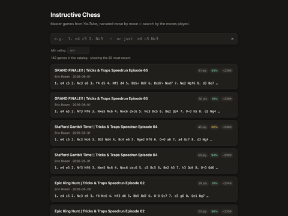
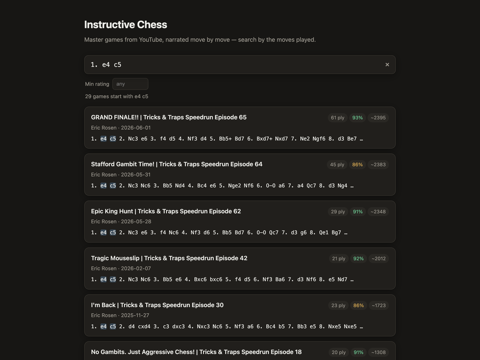
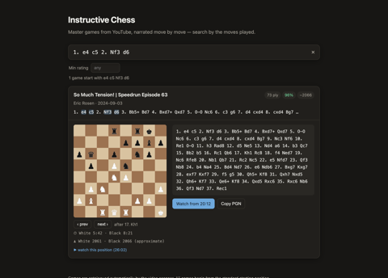

# Instructive Chess

**Live site: https://instructivechess.com/**

<p>
  <a href="screenshots/home.png"></a>
  <a href="screenshots/search.png"></a>
  <a href="screenshots/game.png"></a>
</p>

A catalog of **instructive chess games** — games played on YouTube by masters who narrate
every move — that you can search by the moves played.

It is also an R&D project in turning those videos into data an AI can learn from. Computer
vision reads each game off the screen move by move, with both clocks and both ratings; a
benchmark scores every game against the real one played online; and each video's narration
is kept with its timings, so what the master said can be lined up with the move they were
playing.

Two parts:

| Part | What it is |
|------|------------|
| `scanner/` | A Python tool. Give it a YouTube URL; it downloads the video, reads the on-screen board with computer vision, reconstructs each game move-by-move, and appends the games to `web/data/games.json`. |
| `web/` | A dependency-free static site. Loads `games.json`, lets you type PGN, and lists games whose opening matches. |

All games are assumed to start from the standard starting position.

### Where it's going

The database page stays: finding real games in the line you play is useful on its own. The
next step is an **AI opening and position instructor** built on the same data. Ask it about a
position and it answers from games that reached it, in the words of the masters who played
them, explaining why they chose a move, what they were worried about and how the game went.

That depends on the data being right, so the work so far has gone into accuracy. Every game
is benchmarked against the real game, and the site only shows the moves the scanner can
vouch for; the bar is that none of them is wrong on the benchmark. Next comes lining the
commentary up with the moves, then the instructor itself.

The design notes for it are in [`ASSISTANT.md`](ASSISTANT.md).

### The catalog so far

<!-- README_STATS {"games": 2954, "videos": 549, "listed": 1739, "checked": 2483, "checked_pct": 84.1, "moves": 75.2, "clocks": 79.3, "ratings": 74.9, "shown_moves": 62067, "shown_wrong": 0, "date": "2026-10-30"} -->
**2,954 games** from **549 videos**, of which **1,739** are listed on
the site. 2,483 of them (84.1%) have been found in the chess.com or lichess
archives and checked against the real game:

| Of the games checked against the real game | |
|---|---|
| Every move right | 75.2% |
| Clocks: at least 95% of readings within 2 s | 79.3% |
| Ratings: both players within 20 points | 74.9% |
| Wrong moves shown on the site | 0 of 62,067 |

These figures cover only the games that could be found in the archives. The rest often
couldn't be matched because the scanner read too little of the game to tell which one it
was, so accuracy over the whole catalog is probably lower. The site shows only the moves the
scanner is sure of, so a game with a misread move is cut short rather than shown wrong.

*Last updated 2026-10-30 by `scanner/tests/readme_stats.py`.*
<!-- /README_STATS -->

---

## Web app

Nothing to build. Serve the folder:

```sh
python3 -m http.server -d web 8000
# open http://localhost:8000
```

- Empty search box → the 20 most recent games.
- Type moves (`1. e4 c5 2. Nc3`, or just `e4 c5 Nc3`) → every game whose mainline **begins
  with exactly those moves**. An illegal move filters on the legal prefix and says so.
- Filters: **Narrator plays** (White / Black) — the point is to watch the *narrator* play the
  line you searched for, not their opponent; **Min rating** (both players at least this;
  games with no readable rating are excluded while the filter is active); **Exclude
  speedruns** (the narrator climbing a fresh account against much weaker opponents).
- Each card names the side the narrator played, and expands to a step-through board, the
  clocks and ratings read from the video, and the full PGN. Each result links to the video
  at the game's timestamp.
- Only the moves the scanner is sure of are shown and searched (see `scanner/trust.py`):
  measured against the real games, none of those moves is wrong, and the whole 15-move
  opening is shown for a little under half of the games.

The only runtime dependency is `web/vendor/chess.js` (MIT), vendored locally — the page
makes no network requests.

---

## Scanner

### One-time setup

```sh
python3 -m venv scanner/.venv
scanner/.venv/bin/pip install -r scanner/requirements.txt
brew install ffmpeg          # video decoding / muxing
brew install tesseract       # OCR engine used to read on-screen clocks and ratings
```

### Catalog a video

```sh
scanner/.venv/bin/python scanner/scan.py "https://www.youtube.com/watch?v=ao5Xxv7HqQ8"
```

This writes new entries into `web/data/games.json` (re-scanning a video replaces its
entries). Add `--dry-run` to print the games without touching the file. A full-length
video takes a few minutes (download + ~1 fps frame scan + reconstruction).

### How it works

1. **Download** — `yt-dlp` fetches the video (≤720p is plenty) into `scanner/cache/`;
   `ffmpeg` decodes it down to ~1 fps of stills.
2. **Locate the board** — a coarse 8×8-checkerboard search plus gradient-based grid
   refinement finds the board rectangle.
3. **Self-calibrate** — on the first frame that shows an opening setup, the board box is
   nudged onto the pieces and the 32 pieces are cropped straight out of the video and used
   as templates. Same renderer, same theme, same scale, so later matching (masked
   cross-correlation) is near-exact and immune to square colour and last-move / check
   highlights. Because the templates come from the video itself, any digital piece set
   works with no extra assets.
4. **Read every frame**, majority-vote each square over a short time window to kill
   flicker.
5. **Reconstruct** — replay legal moves from the start position, bridging small gaps and
   stepping over noisy frames, until a game can't be continued or a new opening appears.
   If a video skips the pristine starting position (common in recap videos), a game is
   still opened from any position that's a short *unique* continuation of the standard
   start. Correctness is favoured over length: an unresolved position ends the game
   rather than guessing, and `confidence` reports the fraction of moves resolved with no
   ambiguity.

### Useful flags

| Flag | Purpose |
|------|---------|
| `--dry-run` | Print games; don't write `games.json`. |
| `--fps 2` | Sample more frames (helps on fast games; slower). |
| `--start / --end SECONDS` | Scan only part of the video. |
| `--calibrate` | Write `scanner/cache/<id>-calib.png` with the detected board boxed, then exit. |
| `--crop x,y,w,h` | Skip auto-detection and use this board box. |
| `--min-confidence 0.7` | Drop reconstructed games below this confidence. |
| `--speedrun` / `--no-speedrun` | Tag the video's games as (not) a speedrun; by default decided from the title. |
| `--catalog PATH` | Write to a scratch catalog instead of `web/data/games.json`. |

Each game records which colour the narrator played (`pov`, from the board's orientation -
a player's own live board has their side at the bottom) and whether the video is a
speedrun. `scanner/catalog.py` re-derives both tags for an existing catalog without
rescanning.

### Transcripts

`scan.py` also saves the video's YouTube transcript (the uploader's captions if any,
else the automatic ones) to `scanner/cache/transcripts/<video_id>.json` as timed segments, so the
narrator's commentary can be lined up with the moves later via each ply's
`move_seconds`. Backfill or refetch with:

```sh
scanner/.venv/bin/python scanner/transcript.py --all        # every catalogued video
scanner/.venv/bin/python scanner/transcript.py VIDEO_ID     # one video (--force to refetch)
```

The text is kept raw: automatic captions mangle chess notation, and the catalog's moves
are the ground truth.

### Scope

Tuned for **digital boards** (lichess, chess.com, analysis GUIs) shown head-on. The piece
set and board theme don't matter — templates are learned from the opening frame of each
video. What it needs is a video that opens on the standard starting position and a board
that stays put.

### Tests

```sh
scanner/.venv/bin/python -m pytest scanner/tests/   # scanner: move reconstruction
node web/lib.test.mjs                               # web: query parsing + matching, version stamps
node web/stamp.mjs                                  # after editing any web file: re-stamp index.html
scanner/.venv/bin/python scanner/tests/benchmark.py # accuracy of the whole catalog vs the real games
```

`tests/benchmark.py` matches each catalogued game to its real game (linked from the video
description, or in the chess.com archives of the channel's known accounts) and scores the
moves, clocks, ratings and narrator side. To see *why* a video's games came out the way they
did, `tests/dump_readings.py VIDEO_ID` caches the per-frame board readings and
`tests/trace_video.py VIDEO_ID --readings` replays them with a trace, showing each game
against its real game and the readings around the first wrong move.
`scanner/EXPERIMENTS.md` logs what has been tried.

## Data and licence

The code is MIT licensed (see `LICENSE`). The licence covers the code only: not the videos,
and not anything taken from them.

The web page includes two GPL-3.0 components, copied unmodified into `web/vendor/` with their
own licence files: [chessground](https://github.com/lichess-org/chessground) (the search
board) and [Stockfish.js](https://github.com/nmrugg/stockfish.js) (the optional engine, the
lite single-threaded build of [Stockfish](https://stockfishchess.org)). The project's own files
stay MIT; the page as a whole is distributed under the GPL's terms, with all its source here.

The catalog in `web/data/games.json` is the one piece of scanned data in the repo. It is a
set of factual records about other people's videos: the moves, clocks and ratings of each
game, with the video's title, channel and a link back to it.

Everything else the scanner gathers lives in `scanner/cache/`. That folder stays out of git,
partly because it is large (mostly the videos) and partly because most of it is other
people's work, which isn't ours to publish:

| In `scanner/cache/` | What it is |
| --- | --- |
| `<video_id>.webm` / `.mkv` / `.mp4` | the downloaded videos |
| `<video_id>.info.json` | YouTube's metadata for each video (title, channel, upload date, description) |
| `<video_id>-readings.json` | the board read from every sampled frame; rebuilds start from these instead of the video |
| `transcripts/<video_id>.json` | each video's YouTube captions, as timed segments |
| `hires/` | full-resolution frames, kept for reading the players' ratings |
| `truth/` | the real games, from chess.com and lichess, that `tests/benchmark.py` scores against |

None of it has to be shared, because you can rebuild it yourself. Rescanning the catalogued
videos downloads them again and recreates the metadata, readings, transcripts and frames:

```sh
scanner/.venv/bin/python scanner/tests/rescan.py --out /tmp/rescanned.json   # every video in the catalog
scanner/.venv/bin/python scanner/tests/benchmark.py                          # fetches the real games into truth/
```

A video that has since been taken down can't be rebuilt, and a rescan uses the current
scanner, so its games may differ slightly from the published ones.
